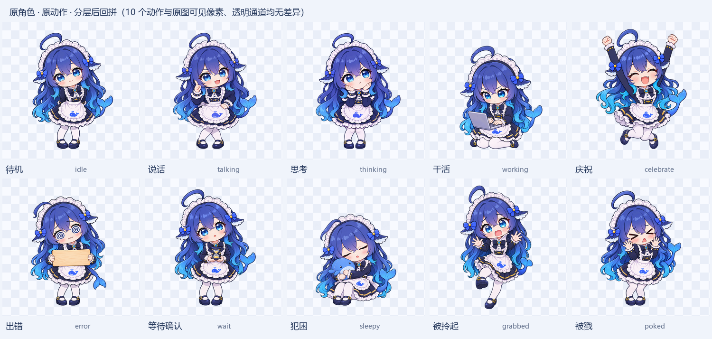

<div align="center">


# Whalemate · 鲸伴

**一只住在你 Windows 桌面上的鲸鱼少女。会动、会记事、会说话，也能帮你干活。**

简体中文 | [English](README.en.md)

[](LICENSE)


[功能](#-功能) · [快速开始](#-快速开始) · [配置](#️-配置模型与-key) · [路线图](#️-路线图) · [参与贡献](#-参与贡献) · [致谢](#-致谢) · [许可](#-许可与声明)

</div>

---

Whalemate（鲸伴）是一个常驻 Windows 桌面的 AI 伙伴。默认角色是 DeepSeek 鲸鱼的二创少女“大肥鱼”：
她在桌面上动来动去，记得你们聊过的事，用自己的声音回话，会闹点小脾气，你交代的事情她也会动手去做。

和普通的聊天客户端不同，Whalemate 关心的是“她是谁”：**换了模型，她还是她**。人格、记忆、关系和渠道彼此独立，
你可以随意更换模型服务、塑造她的性格，在桌面和 QQ 上跟同一个她说话，你们的共同经历不会丢。

> [!NOTE]
> 项目在积极开发中，部分功能还没做完。下面的列表会标出哪些已经可用、哪些还在路线图上；
> 每项功能的实际状态以 [docs/implementation_status.md](docs/implementation_status.md) 为准。

<div align="center">

</div>

## ✨ 功能

### 🐋 桌面角色
- 透明无边框的桌宠，只有角色本身响应鼠标：单击戳她、拖动拎起、双击快速输入。
- 分层网格骨骼动画，有待机、说话、思考、干活、犯困、庆祝等十种状态；全屏应用在前台时自动让开。
- 角色以“角色包”的形式组织（人设、台词、模型绑定、形象），也支持导入标准 Live2D Cubism 3/4 模型。

### 💬 聊天与表达
- 流式回复，连发几条消息会合并成一轮，可以随时打断。
- 表情包、动作和情绪参数随回复一起出现；思考过程不会出现在气泡、语音或日志里。
- 没配置模型时用离线模拟回复运行，不需要 API Key 也能先把界面跑起来。

### 🔊 语音与通话
- 回复默认带语音。“智能朗读”会挑重点念长回复，代码、路径、表格和清单不照着念。
- 语音合成可选 Breeze Blue、千问、智谱或 Windows 系统朗读；云端合成失败时自动退回本地朗读，回复照常完成。
- 语音通话：WebRTC VAD 断句，云端（千问、智谱）或本地 SenseVoice 识别，你一开口她就停下来听。
- 支持日语配音：聊天和字幕保持中文，只把念出来的句子翻译成日语。

### 🧠 记忆与关系
- 带衰减的记忆卡和归档，记得来源；你明确删除的内容不会被改个说法再记回来。
- 用 SQLite FTS5 召回更早的聊天和以前办过的事，每次请求的上下文大小有预算控制。
- 情绪由事件推动并慢慢回落：被冷落会委屈，被哄会消气。好感是长期关系，一次吵架不会清零。
- 人格包可以新建、编辑、切换、回退版本，也能导入导出（兼容 SillyTavern 角色卡的常用字段）。换人格不会清空记忆。

### 🛠️ 帮你干活
- 基于 [DeepSeek Harness](https://github.com/deepseek-ai/deepseek-harness) 规划任务，由桌宠自己的工具执行，敏感操作先问你。
- 通过 MCP 协议对接工具，服务只监听本机回环地址，令牌每次随机生成。
- 支持 DeepSeek 和 MiniMax 两条路线。

### 💬 QQ 接入
- 用 [AstrBot](https://github.com/AstrBotDevs/AstrBot) + [NapCat](https://github.com/NapNeko/NapCatQQ) 接入 QQ，桥接插件见 [integrations/astrbot_plugin_aicompanion](integrations/astrbot_plugin_aicompanion)。
- QQ 上和桌面上是同一个她，共用人格和记忆。她能分清主人、群友和陌生人，私下的事不会在群里说。
- 设置里可以一键安装：组件从官方地址下载固定版本，校验后安装，连接只开在本机。

### 🔐 安全与隐私
- API Key 用 Windows DPAPI 加密保存，数据库里只存引用；不同服务的 Key 不会互相借用。
- 聊天记录、记忆和设置都存在本地 SQLite，升级迁移前会自动备份。
- 每天的用量和额度在本地统计。

## 🚀 快速开始

### 环境要求

- Windows 10 / 11（x64）
- Python 3.11 或更高（开发环境用的是 3.14）
- 用语音通话时建议戴耳机（外放回声消除还没做）

### 安装与运行

```powershell
git clone https://github.com/lsWorl/AICompanion.git
cd AICompanion

python -m venv .venv
.\.venv\Scripts\python.exe -m pip install -r requirements.txt
.\.venv\Scripts\python.exe -m pip install -e .

.\.venv\Scripts\python.exe main.py
```

启动后她会直接出现在桌面上。右键角色或双击托盘图标可以打开聊天面板和设置。
没配置模型时自动使用离线模拟回复；想强制离线，可以设置环境变量 `AICOMPANION_OFFLINE=1`。

### 可选组件

| 组件 | 用途 | 安装 |
| --- | --- | --- |
| 干活（Agent） | DeepSeek Harness 与官方 MCP SDK | `pip install -r requirements-agent-lock.txt` 然后 `pip install -e ".[agent]"`，或运行 `tools\setup_dsh.bat` |
| 本地语音识别 | 离线 SenseVoice（sherpa-onnx） | `pip install -e ".[local-asr]"`，或运行 `tools\setup_local_asr.bat` |
| 形象包工具 | 编译、标注角色形象包 | `pip install -e ".[studio]"` |

基础聊天和桌宠不需要安装这些可选依赖。

## ⚙️ 配置模型与 Key

打开 **设置 → 能力 → 模型与 Key**：

1. 添加一个账户：DeepSeek、MiniMax、Breeze Blue，或者任意 OpenAI 兼容服务，填入它的 Key。
2. 为每种能力分别选择模型：聊天、识图、搜索、办事、语音合成。不同能力可以用不同的服务。
3. 需要的话，可以给某个角色单独指定模型，其余角色跟随全局设置。

Key 用 Windows DPAPI 加密保存，`.env` 里的 `LLM_*` 已经不再读取。
语音识别等少数选项仍然可以用 `.env` 配置，模板见 [.env.example](.env.example)。

在打开界面之前，可以先测试模型连接：

```powershell
.\.venv\Scripts\python.exe -m aicompanion.llm.diagnostics
.\.venv\Scripts\python.exe -m aicompanion.llm.diagnostics "你好，请简单介绍一下你自己"
.\.venv\Scripts\python.exe -m aicompanion.llm.diagnostics --no-stream
```

## 🗺️ 路线图

下一阶段的开发依据是 [项目计划书 v4](docs/project_plan_v4.md)，目标是让她从“会聊天、会办事的桌宠”变成**有自己生活、有情绪、会主动找你、性格由你塑造的伙伴**。

| # | 功能 | 状态 |
| --- | --- | --- |
| 1 | 模型自由切换：每种能力单独选服务和模型，DeepSeek、MiniMax 优先 | 🚧 进行中（聊天、办事已可用） |
| 2 | 可扩展人格包：自己写、导入导出、切换，不丢记忆 | 🔍 审查中 |
| 3 | 持续情绪与小脾气：委屈、撒娇、回怼，也会消气 | 🔍 审查中 |
| 4 | 自己的生活：按兴趣去看、去做，有趣的事主动分享，然后等你回应 | 📋 计划中 |
| 5 | 真正退出：情绪合适时真的关掉自己，下次启动能接上 | 📋 计划中 |
| 6 | 记得住、想得起：混合召回、阶段摘要、整份请求的预算 | 🚧 第一部分审查中 |
| 7 | 圈子与长期事务：群里的长期话题、约定、跨天办事、把文件交给她 | 📋 计划中 |
| 8 | 回复带语音：大肥鱼声线，长回复分段取舍 | 🚧 第一版审查中 |
| 9 | 陪伴日期：认识第几天、纪念日，到了那天自己提起 | 📋 计划中 |

已知限制：外放回声消除、流式识别字幕、安卓客户端、干净 Windows 环境的安装验收还没有完成。详见 [implementation_status.md](docs/implementation_status.md)。

## 🏗️ 架构

单进程，后台工作放在线程里。技术栈：Python + PySide6 + SQLite，不依赖额外的数据库或守护进程。

```text
            ┌───────────────── 渠道 ─────────────────┐
            │  桌宠 / 聊天面板     QQ（AstrBot + NapCat） │
            └────────────────────┬───────────────────┘
                                 ▼
       ┌──────────────────── 大脑（只有一个） ───────────────────┐
       │  人格包 · 情绪 · 关系 · 记忆召回 · 上下文预算               │
       │  ChatController：一次回复只调用一次模型                   │
       └──────┬──────────────────┬──────────────────┬─────────┘
              ▼                  ▼                  ▼
          模型路由              表达层              办事（Agent）
   DeepSeek / MiniMax     语音 · 表情包 · 动作     DeepSeek Harness
     / OpenAI 兼容            · 口型              + 本地工具与审批
```

设计上遵守五条长期约束（见 [docs/architecture-principles.md](docs/architecture-principles.md)）：

1. 角色身份独立于模型：换模型不改变她是谁。
2. 人格独立于记忆：换人格不清空共同经历。
3. 关系独立于渠道：同一个人跨渠道识别需要身份关联和授权。
4. 表达独立于 Agent：Agent 可以换，她的说话方式和关系状态保留。
5. 用户拥有角色塑造权：人格可以自由创作和切换，但不能绕过安全边界。

### 目录结构

```text
src/aicompanion/
  app.py                  # 应用启动
  config.py               # 配置加载
  controllers/            # 对话流程编排（ChatController 等）
  brain/                  # 记忆卡、关注点与目的提炼
  domain/                 # 角色、情绪、人格等领域模型
  llm/  providers/        # 模型客户端与供应商路由
  relationship/           # 关系与好感
  services/               # 记忆、提醒、主动行为
  speech/  voice/         # 语音合成、识别与朗读策略
  pet/  body/  avatar/    # 桌宠窗口、骨骼动画、形象
  expression/             # 表情包与动作
  agent/                  # 干活：Harness 桥接、工具、审批
  qq/  bridge/  community/  # QQ 渠道与社区词库
  storage/                # SQLite 表结构与迁移
  characters/             # 内置角色包
  ui/                     # PySide6 界面
integrations/             # AstrBot 插件
tools/                    # 构建、自检、形象包工具
tests/                    # 单元测试（不联网、不调用真实模型）
docs/                     # 计划书、任务说明、实施记录
```

各模块的详细说明见 [docs/module_guide.md](docs/module_guide.md)。

## 🧪 开发与测试

```powershell
# 离线检查：单元测试 + 桌宠自检，每个 PR 都要跑
tools\run_checks.bat

# 改到“干活”时再跑：会调用真实模型，产生少量费用；只读进程环境里的 DEEPSEEK_API_KEY，不读 .env
tools\run_agent_checks.bat

# 打包 Windows 版本（目录式 PyInstaller）
.\.venv\Scripts\python.exe tools\build_windows.py
```

自检脚本使用临时数据库，不读取你的聊天记录，不联网。

## 🤝 参与贡献

欢迎提 Issue 和 PR。开始之前请先读一下：

- [AGENTS.md](AGENTS.md)：协作规则、分支命名（`task/<编号>-<主题>`）和 PR 要求
- [docs/project_plan_v4.md](docs/project_plan_v4.md)：当前阶段的范围和优先级
- [docs/tasks.md](docs/tasks.md)：任务清单，开工前把任务标成“进行中”，避免重复劳动

几条基本要求：

- 新功能要配单元测试，测试不依赖网络和真实模型。
- 引入新依赖前先说明理由和许可，并锁定版本。
- 界面文字、注释和文档使用中文。
- 合入后在 `docs/implementation_status.md` 末尾追加记录，**写清楚哪些还没验证**。
- 不要提交 `.env`、数据库、私人立绘或试听音频。

## 🙏 致谢

Whalemate 站在许多开源项目和社区创作者的肩膀上，在此一并感谢。下面的“怎么用的”一栏说明了我们和每个项目的关系：
**依赖**是运行时直接使用；**参考**是只借鉴了设计思路、数据格式或做法，没有复制代码（对 GPL / AGPL 项目尤其如此）。

### 运行时依赖

| 项目 | 怎么用的 |
| --- | --- |
| [Qt for Python (PySide6)](https://doc.qt.io/qtforpython/) | 桌宠窗口与全部界面 |
| [DeepSeek Harness](https://github.com/deepseek-ai/deepseek-harness) | “干活”的规划与模型路由（含 MiniMax 路由） |
| [MCP Python SDK](https://github.com/modelcontextprotocol/python-sdk) | 桌宠工具通过 MCP 对接 Harness |
| [AstrBot](https://github.com/AstrBotDevs/AstrBot) | QQ 渠道的平台接入与插件机制 |
| [NapCat](https://github.com/NapNeko/NapCatQQ) | 把 QQ 接成 OneBot 协议 |
| [uv](https://github.com/astral-sh/uv) | QQ 一键接入时安装 AstrBot 运行环境 |
| [sherpa-onnx](https://github.com/k2-fsa/sherpa-onnx) | 本地 SenseVoice 语音识别 |
| [py-webrtcvad](https://github.com/wiseman/py-webrtcvad) | 通话中的语音端点检测 |
| [SQLite FTS5](https://www.sqlite.org/fts5.html) | 旧聊天与旧事的全文召回 |
| [Live2D Cubism SDK](https://www.live2d.com/)、[PixiJS](https://github.com/pixijs/pixijs)、[pixi-live2d-display](https://github.com/guansss/pixi-live2d-display) | 导入外部 Live2D 模型时的渲染 |

### 设计参考

| 项目 | 参考了什么 |
| --- | --- |
| [Coopanion](https://github.com/Pal-AI-Lab/Coopanion) | 桌宠伙伴的整体形态（AGPL-3.0，只参考设计，不使用其代码和贴图） |
| [surfcore](https://github.com/Mieksido/surfcore) | 衰减记忆卡、全量存档、目的机制与“有生活”的大脑设计 |
| [Open-LLM-VTuber](https://github.com/Open-LLM-VTuber/Open-LLM-VTuber) | 语音打断、轮次判断、边生成边分段合成 |
| [MaiBot](https://github.com/Mai-with-u/MaiBot) | 什么时候开口、什么时候安静，认识人和社区语言 |
| [SillyTavern](https://github.com/SillyTavern/SillyTavern) | 角色卡字段、世界书与导入格式 |
| [Mem0](https://github.com/mem0ai/mem0) | 记忆的更新、更正与合并 |
| [Graphiti](https://github.com/getzep/graphiti) | 带有效时间和来源的事实建模 |
| [LangGraph](https://github.com/langchain-ai/langgraph) | 检查点、等待审批与暂停恢复的思路 |
| [GPT-SoVITS](https://github.com/RVC-Boss/GPT-SoVITS)、[CosyVoice](https://github.com/FunAudioLLM/CosyVoice) | 本地声线服务的接入方式（只调用接口，不打包模型） |

### AstrBot 社区插件

| 项目 | 参考了什么 |
| --- | --- |
| [astrbot_plugin_dsh](https://github.com/CCYellowStar2/astrbot_plugin_dsh) | 把聊天会话转给本机 Harness 的消息与追问适配 |
| [astrbot_plugin_meme_manager](https://github.com/anka-afk/astrbot_plugin_meme_manager)、[astrbot-meme-pack-index](https://github.com/anka-afk/astrbot-meme-pack-index) | 表情包的逐轮解析、候选复验与表情包索引协议 |
| [astrbot_plugin_say_picture](https://github.com/mjy1113451/astrbot_plugin_say_picture) | QQ 头像的获取方式 |
| [astrbot_plugin_self_learning](https://github.com/lateautumn233/astrbot_plugin_self_learning) | 观察群友的表达习惯和反馈 |
| [astrbot_plugin_user_memory](https://github.com/Himukai-Kanata/astrbot_plugin_user_memory) | 按人分开的记忆 |

### 大肥鱼社区

特别感谢大肥鱼同人社区的各位创作者，她的性格、口癖和声音感觉都来自大家的共同创作。

| 项目 | 参考了什么 |
| --- | --- |
| [dsh-nekowhale-stickers](https://github.com/Loping151/dsh-nekowhale-stickers) | 大肥鱼表情素材与知识库的来源标注（素材作者：可以叫我云大人 / 雾雪） |
| [bluedafeiyu](https://github.com/lmy414/bluedafeiyu) | 大肥鱼档案站与图片权利说明 |
| [astrbot_plugin_feiyu_voice](https://github.com/Esmerubphire/astrbot_plugin_feiyu_voice)、[WhaleTalk](https://github.com/Tokimorphling/WhaleTalk-) | 大肥鱼声线的听感、固定台词预合成、按音量驱动口型 |
| [dsh-whale-musume 讨论](https://github.com/deepseek-ai/deepseek-harness/discussions/2262) | 鲸娘形象的社区讨论 |

本仓库**没有**收录上述社区素材；表情包素材需要用户按原作者的许可自行导入。如果你是上述项目的作者，发现描述有误或希望调整署名，欢迎提 Issue。

## 📄 许可与声明

本项目以 [MIT License](LICENSE) 开源。以下内容**不在** MIT 许可范围内，以各自的许可为准：

- `src/aicompanion/assets/live2d/vendor/live2dcubismcore.min.js`：Live2D Cubism Core，适用 [Live2D Proprietary Software License](https://www.live2d.com/eula/live2d-proprietary-software-license-agreement_cn.html)。年营业额 1000 万日元以上的企业分发时需要另外取得 Cubism SDK 发行许可，详见 [assets/live2d/LICENSE.md](src/aicompanion/assets/live2d/LICENSE.md)。
- 其他第三方库和组件，以各自的许可证为准。
- “DeepSeek”“Claude”“ChatGPT”等名称和徽标是各自权利人的商标。

**同人声明**：默认角色“大肥鱼”是网友围绕 DeepSeek 鲸鱼形象创作的二创角色。本项目与 DeepSeek、Anthropic、OpenAI 等公司**没有任何关联**，也没有得到它们的认可。

**声音声明**：项目不包含、也不分发任何真人声优的声音模型或参考音频。如果你接入自己的音色复刻服务，请只使用自己录制或明确获得授权的声音。

**使用提醒**：她在“干活”时可以操作你电脑上的文件。敏感操作都会先征求你的同意，请在确认前看清楚要执行的内容。

---

<div align="center">
如果你也喜欢她，欢迎点个 ⭐
</div>
