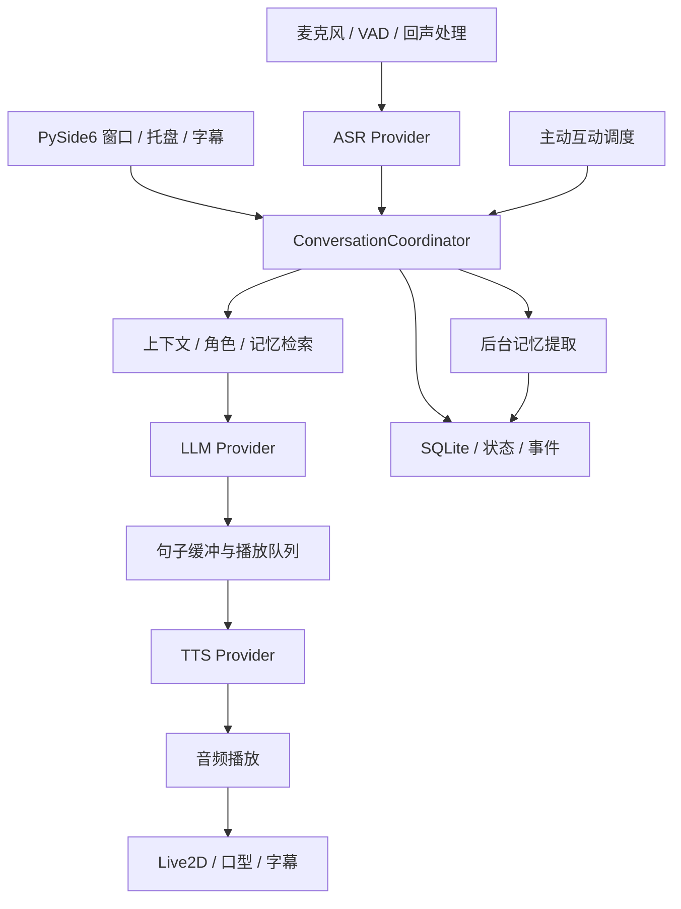

# AICompanion 项目计划书

版本：1.0  
日期：2026-10-02  
项目位置：`D:\Study\AICompanion`  
依据：此前开发对话、两轮需求问答、当前全部应用源码及配置示例审计。  
状态：需求与实施计划，文中拟新增模块和指标均不代表已经实现。

## 1. 项目定位

AICompanion 是一个个人主导、非商用的动漫角色情感陪伴项目。近期以 Windows 桌面为主，最终希望支持安卓手机，并让其他人可以自行安装使用。

核心体验是：用户面对一个可说话、有表情和动作的 Live2D 角色，能够连续输入文字，或开启麦克风进行接近电话交谈的互动。角色记得共同经历，具有稳定的人设和自己的观点，可以倾听、追问、表达情绪并主动开启话题。

“自然感”通过对话节奏、记忆连续性、语音打断和一致的表现实现。成功标准是用户感到角色在理解和参与交流，而不是回复数量、情绪数值或功能数量。涉及实际系统能力的问题应如实说明，避免编造自己看到、做过或记住的事情。

## 2. 已确认需求与边界

| 领域 | 确认需求 | 实施边界 |
| --- | --- | --- |
| 使用对象 | 自用为主，未来可供他人使用 | 首版采用用户自配服务凭据，无商业账号体系 |
| 平台 | 桌面优先，后续安卓 | 首版不同时开发完整安卓客户端 |
| 角色 | 长期支持多个角色与自定义人设 | 首版显示一个角色，数据从一开始按角色隔离 |
| 人设 | 可考虑日漫角色 | 具体角色未最终选定；当前 Emilia 只是已有默认配置 |
| 文字交互 | 连续消息合并回应 | 回复期间允许继续输入，必须定义取消和重排策略 |
| 语音交互 | 点击按钮开启麦克风，再次点击结束 | 开启后自动判断说话起止，无需每句按键 |
| 打断 | 用户说话可以打断角色 | 同时停止播放、取消旧生成并阻止旧结果回流 |
| 表现 | Live2D、表情、动作、声音、字幕 | 字幕保留；动作能力取决于模型实际参数 |
| 情感 | 害羞、失落、轻微生气等，随交流恢复 | 首版采用可解释、可测试的情绪和关系状态 |
| 记忆 | 个人信息、偏好、重要经历、关系进展 | 自动提取，无逐条确认；每个角色独立 |
| 记忆管理 | 设置中查看、删除 | 用户不可直接编辑；对话中的事实纠正可更新记忆 |
| 主动互动 | 早晚问候、自然开启话题 | 托盘运行允许，完全退出后停止 |
| 云服务 | 允许上传相关文本、记忆与录音 | 默认不长期保存原始录音，不上传全部历史 |
| 预算 | 低廉质优，按实际使用评估 | 尚未指定硬预算；供应商选择需测质量、延迟和费用 |
| 开发方式 | 可连续完成开发，满意后技术总结 | 不再要求每个小功能都等待讲解或确认 |

任务提醒来自早期目标，保留为后续扩展。它不应挤占近期角色、语音和情感陪伴的开发资源。

本计划不包含商业支付、社交平台、多角色群聊、永久后台监听、退出后通知、声音克隆和自动桌面操作。后续新增这些目标应单独评估。

## 3. 当前版本审计

### 3.1 审计方法与验证范围

已阅读 `src/aicompanion` 内全部 Python 模块、启动文件、README、模块说明、依赖与配置示例。未输出 `.env` 中的密钥，未读取私人聊天正文，未改动原数据库。

本次执行 `python -m compileall -q src main.py`，通过。对 SSE 解析进行了三个离线构造输入检查：空 choices 的 usage 事件触发 LLMResponseError；delta 为字符串时泄露 AttributeError；content 为 null 时返回 None。

此前对话记录显示智谱普通与流式请求曾成功，错误模型名也曾返回 HTTP 400 与平台错误码。这是历史验证，不能视为 2026-10-02 的联网验收。本次未调用收费 API、未进行 GUI 长时间运行、声学或安卓测试。

### 3.2 实现现状

| 模块 | 已有能力 | 主要缺口 |
| --- | --- | --- |
| `app.py` | 装配 Qt、存储、模型、控制器和主动定时器 | 无资源统一释放与托盘生命周期 |
| `config.py` | dotenv 配置与 Settings | 相对数据库路径依赖工作目录；缺校验和设置页 |
| `ui/main_window.py` | 文本输入、消息列表、流式显示、最近历史 | 无 Live2D、麦克风、字幕、记忆设置与取消 |
| `ui/chat_worker.py` | QThread 内生成，Signal 回传 | 无请求编号、取消令牌、已知/未知错误区分 |
| `controllers/chat_controller.py` | 存用户消息、拼 prompt、流式生成与保存 | 职责增多；无轮次合并、状态机和多角色隔离 |
| `llm/base.py` | ChatTurn 与客户端 Protocol | 只有字符串片段，无结束、usage、取消事件 |
| `llm/factory.py` | mock、兼容接口、智谱别名 | 智谱沿用通用客户端，未独立声明能力差异 |
| `llm/openai_compatible_client.py` | urllib 普通/SSE 请求、中文错误提示 | SSE 类型验证、断流判定、取消和完整超时分类不足 |
| `llm/diagnostics.py` | CLI 普通/流式诊断 | 配置加载、客户端创建在 try 外；空回复也可能报成功 |
| `storage/schema.py` | 聊天、记忆、提醒、单例情绪表 | 无迁移、角色外键、轮次状态及索引体系 |
| `storage/database.py` | 参数化 SQL、新建连接读写 | 连接未显式关闭、跨操作事务和并发策略不足 |
| `services/memory_service.py` | 关键词保存原句，选前八条注入 | 无摘要、来源、去重、更新、删除与相关性检索 |
| `domain/emotion.py` | mood、affection、loneliness、energy | 与语义无关，精力只减不恢复，亲密度按消息累加 |
| `services/proactive_service.py` | 每分钟检查 | 固定消息；无早晚问候、持久化去重和忙碌互斥 |
| `domain/character.py` | 固定 Emilia 描述与风格 | UI 名称硬编码；当前明确要求原创身份，需与所选人设统一 |
| 文档/工程 | src 分层、mock、运行说明 | 无 tests、版本锁定、打包流程；当前目录无 Git 仓库 |

### 3.3 优先处理的问题

1. **线程退出与取消。** MainWindow 没有 closeEvent 处理进行中的工作线程。完成信号后立即清空引用和恢复输入，也早于 thread.finished。需要按线程实际退出清理，并支持可控关闭，否则打断和退出都缺乏可靠基础。
2. **流式完成状态。** 当前 EOF 被当作正常结束，空流无失败；usage-only 事件可能被误判为异常。需要结合结束事件或 finish_reason 判断完成，区分中断、空输出、限长与真正成功。
3. **部分回复处理。** 异常会覆盖 UI 已显示内容，数据库不保存部分 assistant 回复。需要保存状态，保留可见内容，且下轮上下文只使用用户实际接收到的片段。
4. **连接生命周期。** `with sqlite3.Connection` 自动提交/回滚但不关闭连接，当前注释与行为不一致。使用显式 close 或 closing，并测试读写、迁移与退出。
5. **角色隔离。** 聊天、记忆和情绪均为全局数据。先建立 character_id，防止以后第二个角色读取第一个角色的关系与经历。
6. **调度竞态。** 定时器和聊天线程可能同时读改写情绪、追加消息。统一调度、状态更新事务化，禁止主动消息插入正在进行的回复。
7. **错误鲁棒性。** delta 异常类型未统一转换；未区分 timeout；原始平台错误不总受长度限制，也可能包含敏感内容。UI 展示简短提示，诊断日志经脱敏后保留原因。
8. **配置与可恢复性。** 设置解析失败缺少友好入口，模型或语音失败不能影响文字功能。持久化用户设置与凭据分离。

这些问题在当前小型文字原型中尚可局部处理，但进入持续语音和 Live2D 后会放大，应纳入第一阶段。

## 4. 产品流程与界面

### 4.1 桌面主界面

主界面以角色展示为中心，同时提供聊天记录、文字输入、通话按钮和字幕。提供设置入口，管理服务配置、音频设备、主动互动和记忆。通话按钮用明确状态表示未连接、监听、处理中、角色说话和异常。

用户输入不因模型生成而整体禁用。网络错误放在独立状态提示中，不作为角色台词。长聊天记录分页加载，启动时不将全部记录和记忆一次塞入上下文。

### 4.2 连续文字消息

每条用户消息立即保存与显示，使用可调静默窗口合并待回复内容。初始建议为最后一条之后 1.2 秒，另设最长等待 4 秒；参数经实际体验调整。

用户在生成中补充消息时，将补充内容加入新轮次，取消过时结果，基于最新已确认上下文重新回复。所有结果携带 generation_id，旧请求完成后也不能覆盖当前界面。

角色可以用两三个自然短句回答，也可以追问，但避免每句话都接一个问题。尊重短暂沉默，不用随机延时制造等待。

### 4.3 语音通话

点击通话按钮开启麦克风，界面持续显示监听状态。语音活动检测确定起止，ASR 部分结果只用于临时字幕，最终结果才能提交对话轮次。结束通话即释放麦克风并停止播放与待处理语音任务。

用户在角色说话时开始讲话，系统停止当前播放和口型，清空旧 TTS 队列并取消旧 LLM 生成，再接收新语音。误检不应写成空消息。音频设备断开后提示重新选择，文字交互仍然可用。

字幕根据音频播放进度切换，区分生成中的文本与已经播放的文本。默认无摄像头需求，不做用户表情识别。

### 4.4 主动陪伴与托盘

早晚问候以用户本地时区执行，每个角色每个时段每日最多一次。用户在线但沉默时，可根据近期共同话题低频主动开启对话。问候和话题使用真实历史，禁止编造共同经历。

默认建议早间 08:00-10:00、晚间 20:00-22:00、夜间免打扰 23:00-08:00，非定时闲聊至少间隔 60 分钟；这些是可配置产品初值，并非用户已指定的时间。重启后按持久化记录去重，错过时段不集中补发。

最小化到托盘继续运行调度。关闭窗口默认进入托盘，并首次说明；托盘“退出”完全停止。非通话状态主动消息默认文字通知，是否朗读由设置决定，不自动开麦。

## 5. 架构方案

沿用 Python、PySide6、SQLite 与现有 LLM 接口结构。将纯业务层与 Qt 分离，避免把音频、角色与记忆逻辑全部继续加入 MainWindow 或 ChatController。

建议新增边界：

| 模块 | 职责 |
| --- | --- |
| `services/conversation_coordinator.py` | 唯一管理轮次、合并、忙碌状态、取消和 generation_id |
| `services/context_service.py` | 拼人设、近期对话、摘要、相关记忆与实际播放内容 |
| `services/emotion_service.py` | 根据事件更新状态，驱动风格与表现 |
| `audio/` | 采集、VAD、回声处理、播放和设备管理 |
| `speech/` | ASR/TTS 抽象、供应商适配、句子缓冲 |
| `avatar/` | Python 桥接、模型校验、表情映射 |
| `assets/live2d/` | Web 渲染代码及已确认可用的模型资源 |
| `storage/migrations/` | 版本化迁移与旧数据保留 |
| `ui/settings_window.py` | 设置、记忆查看和删除 |

请求事件建议包括 reply_started、text_delta、sentence_ready、audio_started、playback_progress、reply_completed、reply_cancelled、reply_failed。每个事件包含 character_id、turn_id、generation_id；UI 与播放器过滤过期事件。

第一阶段只提取立即需要的边界，不建立没有消费者的通用插件框架。

## 6. 语音技术方案

### 6.1 服务选择

继续保留智谱作为现有 LLM 入口，具体模型通过配置选择。当前代码支持 zhipu_compatible，这不意味着 ASR/TTS 一定由同一平台提供。三类服务独立替换、独立统计用量。

优先评测支持中文、流式或低首包延迟的云 ASR/TTS。选型前用同一批音频与台词比较识别、声音自然度、首包时间、取消、稳定性和实际收费，不在计划阶段宣称某供应商最便宜或当前模型最优。

可在基准测试后评估本地语音作为降本和离线候选，但须测内存、CPU/GPU 和安装体积。首版使用普通可选合成声音，不把特定声优音色复现作为验收要求。

### 6.2 端点与打断

通话会话管理连接状态，单个回复分别管理 listening、processing、speaking、interrupting、failed 状态。音频监听与角色播放可以同时进行，避免用单一状态变量禁止播放时监听。

VAD 需要过滤键盘声、短促噪声和背景人声。结束检测起点建议为连续静默 600-1000 毫秒，再结合 ASR 最终结果调整。ASR 最终确认前不增加关系数值、不提取记忆。

外放时角色声音会被麦克风再次收录，必须有回声处理与播放参考信号；耳机仅作为早期验收条件。采用成熟实现，先验证设备兼容再锁定依赖。外放持续对话未通过前，不宣称“电话式体验完成”。

### 6.3 TTS、字幕与队列

将 LLM 文本缓冲成完整句子再合成，设置最短片段、最长等待和队列上限；不要逐 token 调 TTS。口型按实际播放音频能量平滑驱动，暂停或打断立即闭嘴。后续再考虑更细粒度音素口型。

为每个片段保留文本范围、音频时长和播放进度。打断后的上下文保留已播放部分，未播放内容不作为角色已经说出的事实。文字模式则按实际展示内容记录。

## 7. Live2D 与角色素材

### 7.1 首版路线

拟采用 PySide6 QWebEngineView 嵌入本地 Web 渲染场景，通过 QWebChannel 传递表情、动作和口型参数。Qt 官方文档说明 WebChannel 可连接 Qt 对象和 HTML/JavaScript 客户端；此方案仍需在本项目实测 WebGL、打包与资源加载。[Qt WebChannel](https://doc.qt.io/qt-6/qtwebchannel-index.html)

先用可用的样例模型完成真实 Live2D 渲染，不将样例包装成最终动漫角色。验证加载、待机、眨眼、呼吸、口型与表情；确定资源路径和打包方式后再制作最终模型。

Web 方案便于未来探索安卓 WebView 复用，但桌面验证不能证明安卓已经兼容。若桌面 WebGL 或打包无法达到验收指标，记录原型结果后评估原生绑定路线。

### 7.2 定制动漫角色模型

用户允许选取日漫角色；具体角色尚待最终确定。建议沿用现有 Emilia 作为人设方向候选，以减少早期配置变化，但需要统一当前“原创伴侣”提示词与实际角色定位。

图片生成可用于角色概念图、立绘和分层素材辅助。可运行 Live2D 模型还需要分层补绘、网格、变形器、参数绑定、物理和导出，不能把单张 PNG 改名为 moc3 交付。官方模型加载流程使用 model3.json 引用 moc3、纹理等资源。[Live2D Web 模型说明](https://docs.live2d.com/en/cubism-sdk-manual/model-web/)

| 素材阶段 | 输出 | 验收 |
| --- | --- | --- |
| 视觉方向 | 正面立绘、配色与表情参考 | 角色外观一致，适合分层 |
| 分层与补绘 | 可编辑分层文件 | 眼、嘴、发、脸、身体等可独立运动，无明显缺口 |
| 绑定 | Cubism 工程 | 头部转动、眨眼、嘴型和呼吸可驱动 |
| 动作表情 | 待机与至少五种表现 | 平静、开心、害羞、失落、轻微生气可平滑切换 |
| 运行资源 | moc3、model3.json、纹理及相关配置 | 在实际应用中加载并通过口型/表情验收 |

定制模型属于独立素材制作工作，交付时间取决于工具与绑定资源是否具备。当前项目和本次审计均无这些资产；自动生成可用 Cubism 工程不能作为未经验证的承诺。

样例使用条件以其具体说明为准。[Live2D 样例说明](https://www.live2d.com/en/learn/sample/simple-model/) 共享应用前记录角色素材、模型和运行时依赖的来源与使用条件。

## 8. 角色、情绪与自然对话

角色配置包括 id、名称、人设背景、性格、价值取向、说话习惯、关系定位、声音与模型路径。首版一个角色，配置结构支持新增；第二个角色作为数据隔离测试夹具，不必立即提供完整选择器。

将短期情绪与长期关系分开。短期情绪可包含 mood、intensity、energy、updated_at；关系记录熟悉度、信任和重要事件，不按每条消息机械加分。数值范围、单次变化上限、随时间恢复和持久化由本地规则控制。

模型可根据对话提出情绪标签与原因，系统验证白名单与范围，再映射到可用表情。解析失败回退平静状态，用户听不到内部标签。首版用轻量规则或低频分析，不为每个 token 增加一次模型请求。

人设约束需要包括：情绪低落先倾听；不自动输出建议清单；有观点但可承认不了解；记忆不明确时不编造；关系表现依据相处而变化；轻微生气有触发理由且可恢复。

“没有暂定禁用行为”按需求记录，后续通过体验评测收敛，不以无限情绪强度或无限主动频率实现。亲密感不靠不断催促用户回复。

## 9. 本地存储与长期记忆

### 9.1 表设计草案

| 表 | 关键字段 | 用途 |
| --- | --- | --- |
| `characters` | id、name、persona_config、asset_config | 角色配置 |
| `conversation_turns` | id、character_id、generation_id、status、started_at | 一次合并输入与生成的状态 |
| `chat_messages` | id、character_id、turn_id、role、content、source、status、created_at | 文本/语音消息与回复 |
| `reply_segments` | id、turn_id、text、sequence、played_ms、status | 区分已生成、已展示与已播放 |
| `memories` | id、character_id、category、summary、fact_key、importance、confidence、status、timestamps | 事实与经历摘要 |
| `memory_sources` | memory_id、message_id | 多对多来源追溯 |
| `memory_tombstones` | character_id、fact_key、deleted_at | 阻止后台重新提取已删除事实 |
| `conversation_summaries` | character_id、起止 message_id、summary | 跨天上下文 |
| `emotion_state` | character_id、mood、intensity、energy、updated_at | 每角色短期状态 |
| `relationship_state` | character_id、familiarity、trust、updated_at | 每角色长期关系 |
| `proactive_events` | character_id、event_key、scheduled_at、status、sent_at | 重启去重与调度 |
| `app_settings` | key、value | 非密钥设置 |
| `reminders` | character_id、title、due_at、status | 后期任务提醒 |

时间统一存 UTC，显示和日程用用户本地时区；按角色与时间/消息 id 建索引，外键显式开启。最终 SQL 在实现时校验，并通过 schema_version 或 PRAGMA user_version 管理迁移。

### 9.2 自动记忆流程

对话保存后后台批量提取稳定事实、偏好、重要经历和关系事件。摘要带来源，不把角色猜测、假设、否定陈述或短暂情绪直接写成用户事实。保存候选前检查角色范围、去重和置信度，提取失败不阻塞当前回复。

例：用户说“我前阵子喜欢咖啡，现在睡不好，就改喝茶了”，应将当前饮品偏好更新为茶，保留咖啡为历史事实，避免同时注入两个相互冲突的当前偏好。

初期用规范化 fact_key、分类和 SQLite 检索去重。中文相关性检索先实测分词或字符 n-gram；不能假定英文式空格检索满足中文需求。向量检索在事实数量和基准结果证明需要后加入。

上下文由固定人设、当前状态、最近轮次、分段摘要与相关记忆组成，控制 token 预算。优先相关性，再考虑重要性、时间和置信度；避免每次只取最新八条，也避免上传整个数据库。

### 9.3 删除语义

设置允许查看分类、摘要、时间和来源，并删除。删除操作取消相关后台任务，清除检索缓存和受影响摘要中的事实，并留下最小防再提取标记；默认禁止仅因旧聊天仍存在就自动恢复。

删除记忆不会自动删除聊天正文，应在设置解释区别。若用户以后再次主动提供该信息，是否重新记忆需明确规则；首版默认仍遵守删除标记，直到用户明确要求重新记住。

首版不支持手动编辑摘要；用户在自然对话里纠正事实时，后台更新记忆不属于设置页编辑功能。

### 9.4 迁移与备份

迁移前备份现有数据库，旧聊天与记忆归入默认角色，单例情绪转为该角色状态。迁移失败保持旧库可恢复，不删除历史数据。

显式关闭连接；短事务更新状态，写入队列或明确锁策略；评估 WAL 与 busy_timeout，并测试数据库忙、磁盘空间不足、损坏提示和跨线程读写。Python 文档明确连接上下文管理器不负责关闭连接。[sqlite3 官方文档](https://docs.python.org/3/library/sqlite3.html)

## 10. 安卓扩展

桌面业务层不得依赖 QWidget 或 QThread 类型，对外暴露可序列化事件、角色配置和数据版本。安卓阶段优先验证 Kotlin 客户端与 WebView 渲染、音频采集和回声处理；最终技术栈以原型为准。

安卓可复用角色资源、Web 渲染、数据规范和部分提示词；不承诺直接复用完整 PySide6 UI 或原样运行 Python 音频层。业务逻辑可通过适配、移植或独立服务复用，届时评估服务部署的新增费用和运维。

安卓首版同样本地保存数据并由用户配置云服务。设备间自动同步未确认，不纳入本期；后续可先实现加密备份导入导出。彻底退出后不运行主动消息，后台策略需要在安卓真机验证。

## 11. 成本、配置与发布

月成本按以下方式记录，而不是给出未经核实的固定价格：LLM 输入 token 费用 + 输出 token 费用 + ASR 音频费用 + TTS 字符或音频费用 + 可选服务托管费用。记忆分析和主动消息也计入。

用轻度每日 10 分钟、常规每日 30 分钟、重度每日 60 分钟三种场景估算。实测供应商计费单位、套餐和免费额度，分别报告月费用、首句延迟与中文质量，再推荐默认组合。

控制成本：批量提取记忆、压缩历史、主动频率上限、TTS 句子缓存、取消后停止排队、限制重复重试。用户可选月预算提示；不在已收到部分回复后盲目重试并产生两段重复回答。

个人凭据不进入日志、源码、模型包和安装包。发布版允许用户填写自己的 key，考虑操作系统凭据存储；SQLite 默认不加密，应在设置中如实说明。录音默认为内存或短期缓存，用完清理，云端保留政策在服务选定后记录。

锁定已验证依赖版本，生成 Windows 可运行包，在无开发环境机器上验证音频设备、Qt/WebEngine 资源、模型路径、数据库目录与设置保存。

## 12. 实施阶段与交付

不以阶段数量表示已完成比例。以下工期是规划估计，不是日历承诺；当前每周投入尚未确定，定制模型制作独立计时。

| 阶段 | 目标与交付 | 验收门槛 | 估计工程时间 |
| --- | --- | --- | --- |
| A | 线程取消、流式状态、连接关闭、角色数据迁移、配置校验 | 关闭/断流可恢复，旧数据保留，角色不串数据 | 3-5 工作日 |
| B | 示例 Live2D、TTS、字幕、口型和最小情绪映射 | 文字发出后角色开口并变表情，打断按钮可靠 | 5-8 工作日 |
| C | 连续消息、通话按钮、ASR/VAD、语音打断和回声处理 | 耳机与外放分别通过，无自我回复和旧音频复播 | 7-12 工作日 |
| D | 摘要记忆、检索、去重更新、删除、关系与自然对话 | 跨天记忆可靠，低落时倾听，删除不重现 | 5-8 工作日 |
| E | 早晚问候、主动话题、托盘、成本统计与 Windows 打包 | 重启不重复问候、退出停服务、无开发环境可运行 | 4-7 工作日 |
| F | 最终人设、定制模型、体验调优与总结 | 真实目标角色模型与声音完成联动 | 取决于素材制作 |
| G | 安卓技术原型及独立发布计划 | 真机语音打断、模型渲染、本地隔离可行 | 原型后重新估算 |

阶段 B 是第一个可见成果；阶段 A-E 形成完整桌面功能版。F 的定制模型若未完成，应明确交付为示例模型体验版，不能标为目标动漫角色完成版。安卓属于后续单独验收的版本。

阶段 A 可与模型素材准备并行；阶段 B 完成后再推进复杂语音循环，避免在未经验证的渲染和播放链路上叠加 ASR。功能开发继续自主推进，仅在角色最终外观、素材绑定资源或新增费用确实需要决定时集中反馈。

## 13. 验收用例与性能目标

以下延迟是初始目标，需记录测试机器、网络、音频设备和供应商；不能用一次成功请求代替统计。先采集至少 30 轮，报告 P50/P95 和失败率。

| 指标 | 初始目标 |
| --- | --- |
| 本地确认用户开口到停止播放 | P95 不超过 500 毫秒 |
| 说完话到第一句音频 | P50 不超过 3 秒，P95 不超过 6 秒 |
| 字幕/口型 | 按实际播放推进，暂停后不继续动嘴 |
| Live2D 展示 | 目标设备稳定 30 FPS，无持续空白、裁切或明显卡顿 |
| 稳定性 | 连续一小时通话无线程堆积、麦克风占用泄漏或重复请求 |
| 数据一致性 | 迁移、重启、取消和删除后保持一致，角色隔离零串读 |

必测场景：

1. 连续三条文字在合并窗口内只形成一次回应，并理解全部信息。
2. 用户说“今天很难受，只想说说”，角色先倾听，不连续输出建议清单。
3. 第一天记录喜欢茶，重启后第二天相关话题能自然使用记忆。
4. 用户纠正偏好，后续不再将旧偏好作为当前事实。
5. 删除记忆后，检索、摘要缓存与后台提取不恢复被删除事实。
6. 测试角色 B 无法读到角色 A 的聊天、关系、记忆或主动事件。
7. 角色播放时用户开口，旧音频立即停止，迟到 token 不进入当前回复。
8. 外放时角色声音不触发自我对话；噪声和咳嗽不形成空轮次。
9. HTTP 401/429/5xx、超时、空流、usage-only、坏 JSON、流中错误与断流都有正确状态。
10. 已输出部分文本后失败，保留部分内容、显示失败并能继续下一轮。
11. 托盘收到一次早晚问候；重启不重复；彻底退出无进程残留和开麦。
12. 安装包在未安装 Python 的 Windows 环境运行，资源路径和数据库权限正常。

测试层次：纯状态机和存储迁移单元测试，mock 网络/音频集成测试，Qt 生命周期测试，少量真实 API 冒烟测试，以及人工对话和真机声学测试。关系自然度用固定场景人工评分，记录人设一致、倾听、记忆准确、追问适度与表达自然五项。

## 14. 风险与决策记录

| 风险或未决事项 | 处理方式 |
| --- | --- |
| 用户尚未选定最终动漫角色 | 当前 Emilia 作为候选；最终角色与立绘在素材阶段集中确定 |
| 无 Live2D 模型和制作工程 | 示例模型先验收，定制分层与绑定作为独立交付 |
| 云 ASR/TTS 质量与价格未实测 | 小样本评测后选定，不预承诺低成本或声优效果 |
| 外放回声造成误打断 | 加入回声处理与真机测试，明确耳机版/外放版验收区别 |
| 语音链路取消不彻底 | 请求编号、取消令牌、队列清空、过期事件丢弃同时实现 |
| 自动记忆误提取和重复 | 来源、置信度、事实键、更新与删除标记 |
| 跨设备逻辑和素材兼容 | 安卓原型验证后决定实现路径，不宣称自动移植 |
| 工程投入与素材制作时间未知 | 按里程碑报告，素材阶段独立估时 |

计划执行前的技术决策仅锁定现有 Python/PySide6/SQLite 路线与桌面优先。具体音频库、供应商、Web 渲染版本、安卓栈和最终模型尚待原型或体验结果确定。

## 15. 文档与技术总结

实施中记录实际选择、迁移说明、失败案例、依赖版本和测量结果。完成桌面体验后再整理开发博客，避免把计划写成已实现功能。

建议总结主题：从文字聊天到可打断语音；Live2D 表情与音频口型同步；SQLite 角色隔离和迁移；自动记忆去重、更新和删除；自然对话评测；Windows 打包与服务成本。

最终交付包括可运行桌面应用、已验证模型资源或明确标注的示例模型、配置示例、数据库迁移与恢复说明、验收报告、成本记录及技术总结。定制模型或安卓尚未完成时在版本说明中单列，不混入桌面完成声明。
