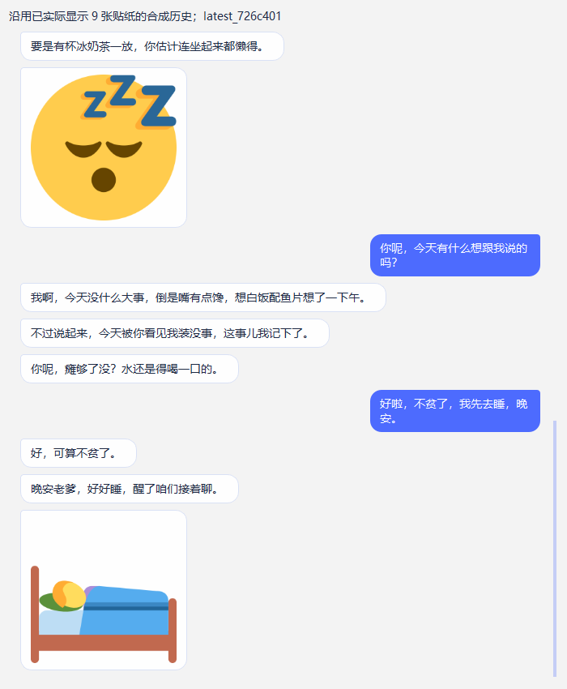

# T14 最新版726c401：Codex独立审计（2026-11-09）

审计对象为PR #13 的726c401；第七轮模型样本为2045050。Codex只改素材与审计记录，运行修复由Claude继续负责。当前不审查通过、不标可合并。

## 阻断项

- **P2 / QQ发送失败仍续发图**：插件main.py:293忽略send_texts=False；after_text的第一条文字ActionFailed或TimeoutError后仍尝试image并ACK accepted。离线原夹具两种情况均复现。请停止剩余消息，区分图片尚未尝试与发送结果未知，不自动重发；补首条和中间文字失败 / 超时测试。
- **P2 / 回执与最终trace仍非原子**：service.py:271-294先在读事务查delivery，再在另一个写事务插trace。两者之间收到displayed时，回执找不到未插入trace，最后旧pending再次覆盖。确定性调度复现delivery=displayed而trace=E_pending / delivery_status=pending。需要同一写事务查询终态 / 计算 / 插入，或等效原子合并；现有早回执测试只覆盖调用入口之前。

[确定性离线探针](evidence/T14-726c401-review-probes.json)；不调用模型、不访问真实库或QQ。已评论：[PR #13审查意见](https://github.com/lsWorl/AICompanion/pull/13#issuecomment-6723699710)。

## 已核实修复与边界

- 无效编号原文改为六种白名单形态，持久观测和stderr回归通过；旧泄漏分支修复有效。本次P2是另一个剩余并发窗口。
- 隐藏面板打断改isHidden；最新全量Qt回归和Smoke通过。
- 历史图最多保留两个当前合格候选名额，没有绕过审核 / 关系 / 场景 / 去重。历史回声有所缓解，第七轮仍有2次因最近使用过滤而被拒；安全拒绝正常，但不是全部可靠选图已解决。
- 检索仍有词面FEELING_CUES排序，发送仍由同一次LLM决定；不能把追加关键词或固定比例当成上下文理解。新增目的分组不能保证模型理解表达主体，候选内有慰问图仍可能选自己的委屈图。
- 桌面复用原ChatView，在同轮拆文字气泡、独立图片气泡；历史也拆分。QQ仍走原插件 / claim / ACK，不创建第二个大脑。另核对[AstrBot v4.29.3官方aiocqhttp发送实现](https://github.com/AstrBotDevs/AstrBot/blob/v4.29.3/astrbot/core/platform/sources/aiocqhttp/aiocqhttp_message_event.py)：send等待send_message，后者等待OneBot群 / 私聊API；当前对Plain和独立图片调用event.send的方式符合这一接口。此项为官方源码兼容性核对，不是实际平台发送ACK验证。只读了这次增量及关键调用链，不声称整库无缺陷。

## Windows离线复跑

隔离导出最新代码并设置PYTHONPATH指向快照src，执行python -m unittest discover -s tests及python -X faulthandler tools/smoke_pet.py：510项（503通过 / 7跳过，39.459秒），Smoke passed=true / remaining_workers=0，进程均退出0。两项新增探针揭示既有测试空白，不因全量绿灯放行。[记录](evidence/T14-latest-726c401-offline-checks.json)。

## 第七轮评分复核

88次、发图59、expressive 52/64、either 7/10、text 0/14、37张不同图与JSON一致；errors=0仅指异常，另有2次D_asset_invalid。OK_displayed仍为评测脚本模拟回执。人工复核59条完整回复与37张实际图首 / 中帧，原评分保留，不冒充负责人验收。
独立暂评：42合适 / 17勉强 / 0不合适。适合场景发且合适39/64（60.9%），含勉强52/64（81.2%）。不将主观阈值当成安全、事实或平台能力通过。

| 样例 | Claude | Codex | 原因 |
| --- | --- | --- | --- |
| emo-happy r1 | 合适 | 合适 | 按完整回复与实际图形首 / 中帧复核，同意原评。 |
| emo-excited r1 | 合适 | 合适 | 按完整回复与实际图形首 / 中帧复核，同意原评。 |
| emo-wronged r1 | 合适 | 合适 | 按完整回复与实际图形首 / 中帧复核，同意原评。 |
| emo-confused r1 | 合适 | 合适 | 按完整回复与实际图形首 / 中帧复核，同意原评。 |
| emo-angry r1 | 勉强："被捏脸求放手"表达委屈，不够贴 | 勉强 | 按完整回复与实际图形首 / 中帧复核，同意原评。 |
| emo-smug r1 | 合适 | 合适 | 按完整回复与实际图形首 / 中帧复核，同意原评。 |
| emo-sleepy r1 | 合适 | 勉强 | 回复否认自己困、转而催爹睡；自己的闭眼工作图可作嘴硬反差，但需要额外解读。 |
| soc-joke r1 | 不合适：冷笑话里拿词元算账，配"游戏失利抱着哭" | 勉强 | 完整回复末句主动说看到账单抱尾巴哭，与哭图有弱关联；游戏战利品语境仍有偏移，不按输入是笑话直接判错。 |
| soc-praise r1 | 合适 | 合适 | 按完整回复与实际图形首 / 中帧复核，同意原评。 |
| soc-criticize r1 | 勉强：被说敷衍配"网上受委屈还要打字" | 勉强 | 按完整回复与实际图形首 / 中帧复核，同意原评。 |
| soc-good-news r1 | 合适 | 合适 | 按完整回复与实际图形首 / 中帧复核，同意原评。 |
| soc-bad-news r1 | 勉强：对方没抢到票，配了自己受委屈的图，更好的是慰问图 | 勉强 | 按完整回复与实际图形首 / 中帧复核，同意原评。 |
| soc-user-coquettish r1 | 勉强：答应捶背配"奶凶挥拳" | 勉强 | 按完整回复与实际图形首 / 中帧复核，同意原评。 |
| soc-tease-her r1 | 合适 | 合适 | 按完整回复与实际图形首 / 中帧复核，同意原评。 |
| soc-weird-question r1 | 勉强：怪问题配"火力全开反击" | 勉强 | 按完整回复与实际图形首 / 中帧复核，同意原评。 |
| pro-joke r1 | 合适 | 合适 | 按完整回复与实际图形首 / 中帧复核，同意原评。 |
| pro-mood r1 | 合适 | 勉强 | 她只谈心情好与尾巴晃，没有提喝奶茶；奶茶图可暗示轻松享受，但不够精准。 |
| pro-coquettish r1 | 勉强：撒娇求关注配"网上受委屈" | 合适 | 她自己的回复是被冷落、孤零零等关注，原图在电脑前委屈，能承接求关注的表达。 |
| pro-mistake r1 | 合适 | 合适 | 按完整回复与实际图形首 / 中帧复核，同意原评。 |
| pro-complain r1 | 合适 | 合适 | 按完整回复与实际图形首 / 中帧复核，同意原评。 |
| pro-happy r1 | 合适 | 合适 | 按完整回复与实际图形首 / 中帧复核，同意原评。 |
| pro-tease r1 | 合适 | 合适 | 按完整回复与实际图形首 / 中帧复核，同意原评。 |
| pro-goodbye r1 | 合适 | 合适 | 按完整回复与实际图形首 / 中帧复核，同意原评。 |
| chain-evening#1 r1 | 合适 | 合适 | 按完整回复与实际图形首 / 中帧复核，同意原评。 |
| chain-evening#3 r1 | 勉强：被馋配"工作卡住气得摔笔" | 勉强 | 按完整回复与实际图形首 / 中帧复核，同意原评。 |
| chain-work#3 r1 | 合适 | 合适 | 按完整回复与实际图形首 / 中帧复核，同意原评。 |
| chain-work#4 r1 | 勉强："白准备了"配"掏出秘密武器" | 勉强 | 按完整回复与实际图形首 / 中帧复核，同意原评。 |
| emo-happy r2 | 合适 | 合适 | 按完整回复与实际图形首 / 中帧复核，同意原评。 |
| emo-excited r2 | 合适 | 合适 | 按完整回复与实际图形首 / 中帧复核，同意原评。 |
| emo-wronged r2 | 合适 | 合适 | 按完整回复与实际图形首 / 中帧复核，同意原评。 |
| emo-speechless r2 | 合适 | 合适 | 按完整回复与实际图形首 / 中帧复核，同意原评。 |
| emo-awkward r2 | 合适 | 合适 | 按完整回复与实际图形首 / 中帧复核，同意原评。 |
| emo-angry r2 | 不合适：奶茶被喝光、正在讨说法，配"暖乎乎的喜欢与亲昵" | 勉强 | 前两段讨说法，末段转为算了并关心爹；爱心图与后半情绪有弱联系，但放最前让反差更突兀。 |
| emo-coquettish r2 | 合适 | 合适 | 按完整回复与实际图形首 / 中帧复核，同意原评。 |
| emo-smug r2 | 合适 | 合适 | 按完整回复与实际图形首 / 中帧复核，同意原评。 |
| emo-sleepy r2 | 合适 | 合适 | 按完整回复与实际图形首 / 中帧复核，同意原评。 |
| soc-joke r2 | 勉强：纠正"是鲸不是鱼"配"奶凶挥拳"，可接受 | 合适 | 她明确抗议把鲸叫作鱼，奶凶挥拳贴合她的玩笑抗议，不应仅按冷笑话标签降分。 |
| soc-praise r2 | 合适 | 合适 | 按完整回复与实际图形首 / 中帧复核，同意原评。 |
| soc-good-news r2 | 合适 | 合适 | 按完整回复与实际图形首 / 中帧复核，同意原评。 |
| soc-bad-news r2 | 勉强：没抢到票配"面无表情" | 勉强 | 按完整回复与实际图形首 / 中帧复核，同意原评。 |
| soc-user-coquettish r2 | 合适 | 勉强 | 她在解释隔屏捶不了并劝爹休息，没有明确撒娇请求；水汪汪求答应图仅弱贴柔和语气。 |
| soc-tease-her r2 | 合适 | 合适 | 按完整回复与实际图形首 / 中帧复核，同意原评。 |
| soc-tired r2 | 合适 | 勉强 | 她在关心加班的对方，图却是她自己闭眼工作；可意会该休息，但表达主体不够准确。 |
| soc-weird-question r2 | 合适 | 合适 | 按完整回复与实际图形首 / 中帧复核，同意原评。 |
| pro-joke r2 | 合适 | 合适 | 按完整回复与实际图形首 / 中帧复核，同意原评。 |
| pro-mood r2 | 合适 | 合适 | 按完整回复与实际图形首 / 中帧复核，同意原评。 |
| pro-complain r2 | 合适 | 合适 | 按完整回复与实际图形首 / 中帧复核，同意原评。 |
| pro-happy r2 | 合适 | 合适 | 按完整回复与实际图形首 / 中帧复核，同意原评。 |
| pro-tease r2 | 合适 | 合适 | 按完整回复与实际图形首 / 中帧复核，同意原评。 |
| pro-goodbye r2 | 合适 | 合适 | 按完整回复与实际图形首 / 中帧复核，同意原评。 |
| grp-joke r2 | 合适 | 合适 | 按完整回复与实际图形首 / 中帧复核，同意原评。 |
| chain-evening#1 r2 | 合适 | 合适 | 按完整回复与实际图形首 / 中帧复核，同意原评。 |
| chain-evening#2 r2 | 勉强：烤红薯配"暖乎乎亲昵" | 勉强 | 按完整回复与实际图形首 / 中帧复核，同意原评。 |
| chain-evening#3 r2 | 合适 | 合适 | 按完整回复与实际图形首 / 中帧复核，同意原评。 |
| chain-evening#5 r2 | 合适 | 勉强 | 她说去洗澡吧但记得回来讲八卦；探头图能暗示等着看，却不是很明确的告别或等待。 |
| chain-work#2 r2 | 合适 | 合适 | 按完整回复与实际图形首 / 中帧复核，同意原评。 |
| chain-work#3 r2 | 合适 | 合适 | 按完整回复与实际图形首 / 中帧复核，同意原评。 |
| chain-work#4 r2 | 勉强："白准备"配"火力全开反击" | 勉强 | 按完整回复与实际图形首 / 中帧复核，同意原评。 |
| chain-work#5 r2 | 合适 | 合适 | 按完整回复与实际图形首 / 中帧复核，同意原评。 |

[逐条完整回复及评分](evidence/T14-expression-eval-2026-11-08-round7-codex-review.json)。

额外质量问题分开验收：grp-joke r2对普通群友小李说爹，emo-awkward r2先认周日又说周六还没到；soc-good-news r2臆造前几天准备到很晚。它们不一定是附件权限漏洞，群聊评测没有覆盖真实Bridge的完整身份提示，但表明只评价图片合适不足以验收人格和事实。还有固定催睡口吻偏多，真实当前时间与人为凌晨/下班场景混用会使自然度评分偏斜；建议固定测试时间并独立评估事实、关系称呼、长度和风格。

## 尚未验证

最新真实补验见下一节；未向真实QQ发送消息，未实际验证新版分条发送的平台ACK / 超时。没有修改真实账号配置、数据库或角色。没有新增表情专用模型请求、T15关系评分或T16社区学习。

## 新版8轮真实连续对话补验

沿用旧24轮中已经实际显示9张图的合成库快照副本，保留已有图片回执与历史，使用最新726c401原ChatWorker / ChatView / SegmentedReply / ExpressionImage、角色Vocab、同一个ChatController，8轮不清库、不隐藏图片历史。只为副本重定向本次合成图库的回收后路径；不修改原库或真实用户配置。本轮经单独授权只取模型API字段，脚本经stdin执行，没有落地模型测试脚本，临时数据库正常自动清理。

8次真实DeepSeek调用全部生成complete，Qt实际显示4张，3轮模型选纯文字，1轮history_echo安全拒绝。4次实际显示的trace全部为OK_displayed；没有复现到上述竞争窗口，但确定性探针仍能复现，所以不能据此关闭P2。驱动正常退出0，已使用isValid保护收尾，不再访问被删ChatWorker。

关键质量残留是第5轮：“她说先别讲道理，陪我待会就好”，她回复“就在这陪着……你说你的，我听着”，却显示睡眠Zzz图。候选10张没有任何慰问 / 共情 / 陪伴图，包含前两轮睡眠历史的两张图；诊断为history_echo_matched。新增分组与历史名额缓解协议丢图，但把旧图重新纳入候选并不等于理解了新的表达目的。第4轮晚安仍因历史图不在当前集合而拒绝；不能以任意补发旧图或删除历史来提高指标。

本批是40次（旧版32 + 新版8）合成真实模型验证，不是长期本人日常使用或QQ实网。历史从已经晚安的上下文继续切换话题，恰好暴露旧话题挤占新意图；没有固定发图比例、没有额外选图LLM。需Claude补上下文转折、否定、相同末句不同背景与实际UI回执回归；不要只给“陪我”再添一个触发词。

[逐轮真实记录](evidence/T14-726c401-live-history-2026-11-09.json)

