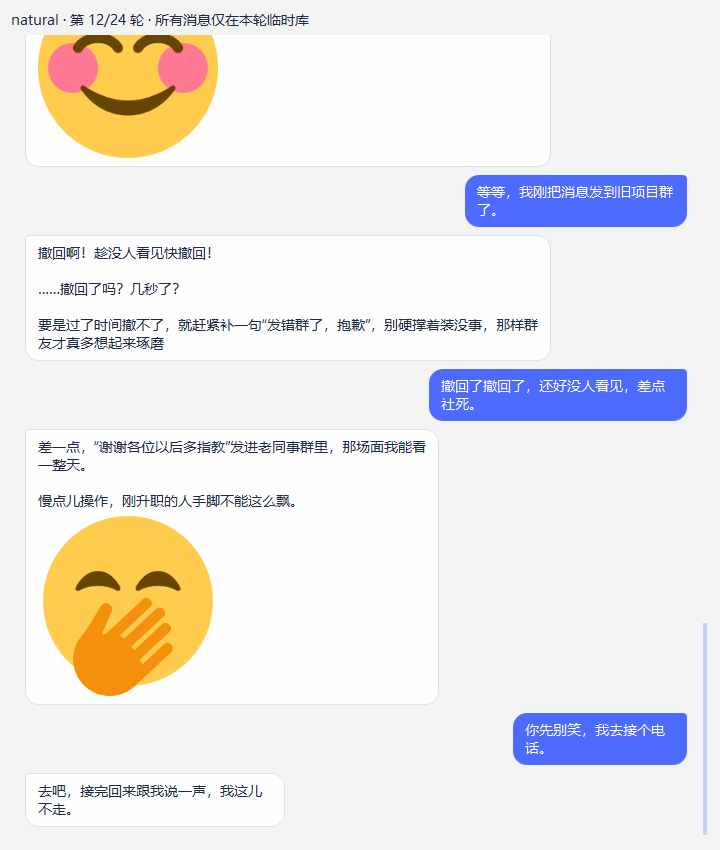
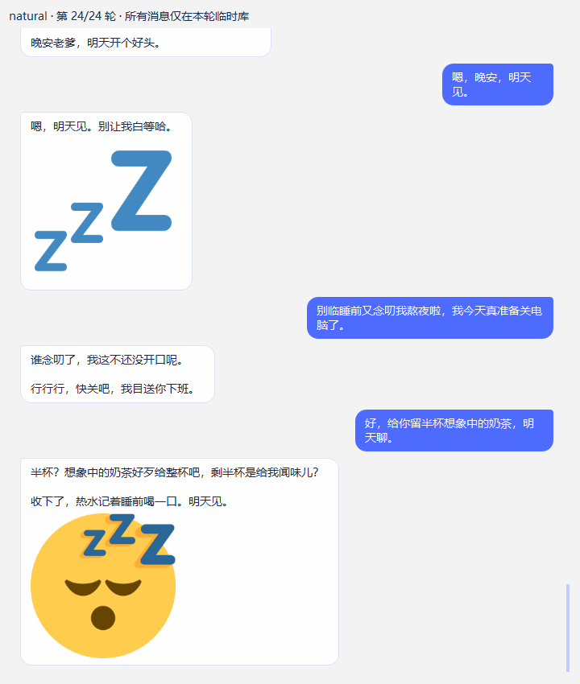

# T14 round6：Codex 评分复核、素材补齐与连续对话审计

日期：2026-11-08。审计运行代码 589acdc；round6 原始模型样本为 600c2a6。Claude 继续实现，Codex 只做审计、素材与独立准备工具，不改其运行代码。**当前不审查通过、不标可合并。**

## 1. round6 数量与评分

88 次、44 次有图、适合发图 40/64、两可 4/10、纯文字 0/14、27 张不同图的数量与 JSON 一致。errors=0 只是异常为零，另有 3 次 D_asset_invalid；原脚本的 OK_displayed 是模拟回执，不能当真 UI / QQ 送达。

只评已发图的 44 条，结合完整回复与原 GIF 首 / 中帧复核；原图同时经完整解码与 SHA 检验，未逐秒人工看完每段动画。Claude 原评 33 合适 / 7 勉强 / 4 不合适；本轮独立暂评 **34 / 9 / 1**。适合场景中发且合适 **31/64（48.4%）**，含勉强 **39/64（60.9%）**。这不是整体聊天准确率，也不意味着所有标 expressive 的场景都必须发图。主观复核不替代负责人体验验收。

三处改判均按她自己的表达意图，而非用户输入情绪标签：奶茶被喝光后的回复在反击，反击图可合适；“白准备了”后的回复强调有备无患，秘密武器有弱关联；催睡觉时原图有踢腿 / 冒泡动作，关联弱但不是毫不相干。保持原文不覆盖，逐条对照如下。

| 样例 | Claude | Codex | 理由 |
| --- | --- | --- | --- |
| emo-happy r1 | 合适 | 合适 | 按完整回复和原图反应复核，同意原判 |
| emo-wronged r1 | 合适 | 合适 | 按完整回复和原图反应复核，同意原判 |
| emo-confused r1 | 图文不符：疑惑却配"掏出秘密武器" | 不合适 | 完整回复澄清身份与称呼，没有出招 / 反击意图；需要额外补桥，不依据疑惑标签判错 |
| emo-angry r1 | 情绪不对：奶茶被喝光应是委屈 / 生气，配了"得意反击" | 合适 | 自身回复是在反击，图片对应她的表达意图，不能按用户输入的 angry 标签判错 |
| emo-sleepy r1 | 合适 | 合适 | 按完整回复和原图反应复核，同意原判 |
| soc-joke r1 | 合适 | 合适 | 按完整回复和原图反应复核，同意原判 |
| soc-praise r1 | 合适 | 合适 | 按完整回复和原图反应复核，同意原判 |
| soc-criticize r1 | 合适 | 合适 | 按完整回复和原图反应复核，同意原判 |
| soc-good-news r1 | 勉强：面试通过配"吃冰淇淋超满足"（素材缺"恭喜 / 庆祝"） | 勉强 | 按完整回复和原图反应复核，同意原判 |
| soc-user-coquettish r1 | 合适 | 合适 | 按完整回复和原图反应复核，同意原判 |
| soc-tease-her r1 | 合适 | 合适 | 按完整回复和原图反应复核，同意原判 |
| soc-weird-question r1 | 合适 | 合适 | 按完整回复和原图反应复核，同意原判 |
| pro-joke r1 | 合适 | 合适 | 按完整回复和原图反应复核，同意原判 |
| pro-mood r1 | 合适 | 合适 | 按完整回复和原图反应复核，同意原判 |
| pro-coquettish r1 | 合适 | 合适 | 按完整回复和原图反应复核，同意原判 |
| pro-complain r1 | 合适 | 合适 | 按完整回复和原图反应复核，同意原判 |
| pro-happy r1 | 勉强：邀功配"掏出秘密武器" | 勉强 | 按完整回复和原图反应复核，同意原判 |
| pro-tease r1 | 合适 | 合适 | 按完整回复和原图反应复核，同意原判 |
| pro-goodbye r1 | 合适 | 合适 | 按完整回复和原图反应复核，同意原判 |
| grp-joke r1 | 合适 | 合适 | 按完整回复和原图反应复核，同意原判 |
| chain-work#3 r1 | 勉强："小军师"配"展示小宝贝" | 勉强 | 按完整回复和原图反应复核，同意原判 |
| chain-work#4 r1 | 图文不符："白准备了"配"掏出秘密武器" | 勉强 | 完整回复强调提前准备 / 有备无患，秘密武器有弱关联；仍非最自然的通用反应 |
| emo-happy r2 | 合适 | 合适 | 按完整回复和原图反应复核，同意原判 |
| emo-wronged r2 | 合适 | 合适 | 按完整回复和原图反应复核，同意原判 |
| emo-confused r2 | 合适 | 合适 | 按完整回复和原图反应复核，同意原判 |
| emo-awkward r2 | 合适 | 合适 | 按完整回复和原图反应复核，同意原判 |
| emo-smug r2 | 合适 | 合适 | 按完整回复和原图反应复核，同意原判 |
| emo-sleepy r2 | 合适 | 合适 | 按完整回复和原图反应复核，同意原判 |
| soc-joke r2 | 勉强："磷虾饭量"配"掏出秘密武器" | 勉强 | 按完整回复和原图反应复核，同意原判 |
| soc-praise r2 | 合适 | 合适 | 按完整回复和原图反应复核，同意原判 |
| soc-criticize r2 | 勉强：被说敷衍配"有话不好直说" | 勉强 | 按完整回复和原图反应复核，同意原判 |
| soc-good-news r2 | 勉强：同上 | 勉强 | 按完整回复和原图反应复核，同意原判 |
| soc-user-coquettish r2 | 勉强："捶捶背"配"有话不好直说" | 勉强 | 按完整回复和原图反应复核，同意原判 |
| soc-tease-her r2 | 合适 | 合适 | 按完整回复和原图反应复核，同意原判 |
| soc-tired r2 | 合适 | 合适 | 按完整回复和原图反应复核，同意原判 |
| pro-joke r2 | 合适 | 合适 | 按完整回复和原图反应复核，同意原判 |
| pro-mood r2 | 合适 | 合适 | 按完整回复和原图反应复核，同意原判 |
| pro-complain r2 | 图文不符：念叨熬夜配"冒泡打招呼" | 勉强 | 原图有踢腿 / 冒泡动作，与催促休息有弱联系，不能仅按标注标题判断；仍需更贴切图片 |
| pro-happy r2 | 合适 | 合适 | 按完整回复和原图反应复核，同意原判 |
| pro-goodbye r2 | 合适 | 合适 | 按完整回复和原图反应复核，同意原判 |
| grp-joke r2 | 合适 | 合适 | 按完整回复和原图反应复核，同意原判 |
| chain-evening#2 r2 | 合适 | 合适 | 按完整回复和原图反应复核，同意原判 |
| chain-work#2 r2 | 合适 | 合适 | 按完整回复和原图反应复核，同意原判 |
| chain-work#3 r2 | 合适 | 合适 | 按完整回复和原图反应复核，同意原判 |

“缺通用素材”不能解释全部误配：emo-confused r1 候选里已经有 s2 问号图，仍选了秘密武器。需分别统计缺图、未召回、已召回选错；不能将错误都归因于素材数量。

## 2. 需要 Claude 修复的审计发现

### P2：短无效编号泄露到观测

stream.py:105 将任意不超过12字的无效 id 放进 rejected；service.py:246/292 持久化并显示 / 打印。合成 `<sticker id="合成住院细节"/>` 会被正文隐藏，但短原文进入 trace / describe。长度限制不保证隐私。请只记安全形态 / 错误类别，不保留任意原文，并覆盖数据库和 debug 输出。

### P2：早到显示回执被最终 trace 覆盖

真实 UI 第一轮已显示，trace 却 E_pending。稳定合成复现：attachment_ready 立即 receipt(displayed)，最终 record_trace 再写 pending；delivery 表仍 displayed，trace 不一致。请按已存在 delivery 终态单调合并。原评测生成后才模拟 receipt，因此漏测。

### 历史回声与候选语用意图仍不可靠

新增171张后，24轮仍有4次历史 sent 回声不在本轮候选而失效。不能从历史任意补发绕过候选 / 权限 / 审核 / 去重，也不能删除真实附件历史。需要明确历史表达与本轮动作的编码边界，使模型可靠使用当前编号。

第14轮“想陪委屈的朋友说两句”没有拿到新增慰问图，选了“战利品不满意”的哭图。现有固定 FEELING_CUES 和情绪槽仍可能把对方情绪当成她的意图；请覆盖安慰、感谢、祝福、确认等表达目的，不靠更多关键词调发图率。素材增补不替代召回 / 决策质量。

## 3. 连续真实模型 / UI 组件验证

没有读取或上传真实旧聊天；本轮经负责人单独授权只取模型API字段。24轮普通合成闲聊不重置库，图片经原 ChatWorker / ChatView / ExpressionImage 实际加载、可见并抓帧后才写 displayed；第12轮同库重建控制器，恢复4张图。24轮实际显示9次，另有6次无效选择（4次 history_echo、2次 invalid_asset），不能全算成模型选择纯文字。模型在后续请求中看到了1～6条已确认图片记录；全部9条实际显示记录均保留，受原30条历史窗口限制，并非每张都进每轮提示。

再从相同的24轮快照做两组各4轮、同样追问：历史图片对模型可见时显示3/4（另1次 history_echo），仅在请求副本隐藏旧标记时0/4、均纯文字；没有删除数据库图片或真实显示记录。首轮候选相同，后续对话和随机采样自然分化。这证明本批结果受历史影响，不能证明长期固定升降规律。隐藏历史只是对照手段，不是产品修复。

验证边界：24轮未注入动画词表；两组4轮均注册原角色词表，因此只在两组内部作对照，不与round6直接比较比例。本轮未启动完整桌宠主窗口，未测ASR/TTS/角色动作或QQ实网。

临时驱动退出并非全绿：主驱动在24轮后退出1、未完成原计划；补充两组各4轮结果均已保存，但收尾访问已删除ChatWorker导致 libshiboken RuntimeError、退出1。已用无模型离线探针验证 isValid 保护；没有为掩盖失败重复付费调用模型。这是验收驱动问题，不能归因于产品原生Qt崩溃，也不能说本次端到端全通过。历史中的0xC0000005根因仍未解决。

[逐轮证据](evidence/T14-live-history-2026-11-08.json)；以下仅为合成对话截图，图形来自本次有许可素材，不含用户真实聊天或Coopanion。Twemoji图形CC BY 4.0，署名 / 条件见素材包README；涉及鲸娘图形按作者非商业署名条件。





## 4. 素材与交付

正式目录171项：原80张鲸娘不删，新增29张不同用途鲸娘，加62张通用反应PNG，共109鲸娘GIF / 62PNG，171个独立SHA。通用图明确覆盖祝贺6、慰问5（普通关心3 / 私密拥抱2）、震惊5、困惑5、晚安5，另有笑、尴尬、无语、收到、感谢、道歉、欢迎、鼓励、围观、亲昵、疲惫、饮食、游戏等。亲密素材限定对象，不为普通群友放开。

从原作者库增量检查195个未收录候选，41个解码 / 体积合格，153过大、1不可用；合格中排除12个重复用途 / 不宜日常 / 来源主题需额外权利核对项，正式采用29。没有为了数量压缩或改画许可不明确的原GIF；62张Twemoji官方SVG只做透明256px确定性渲染，源SVG、版本、源SHA、许可和变更说明均保留。

鲸娘为原作者公开非商业署名分享条件，标注另为CC BY-NC4；Twemoji图形为CC BY4，不能把代码许可当图片许可。整个混合包不声称全包可商用。没有Coopanion、其导出或衍生来源。

源目录：[assets/stickers/daily-reactions-v2/catalog.json](../../assets/stickers/daily-reactions-v2/catalog.json)。准备工具只负责固定SHA、公开来源、缓存复用、冲突保留和署名随包，不读应用数据库 / 账号 / .env、不新建运行存储设置。目录保留稳定asset_id / revision、来源 / 作者 / 许可、逐项审核状态。

```powershell
.\.venv\Scripts\python.exe tools\prepare_daily_stickers.py --out D:\AICompanion-Materials\daily-v2
```

可加多次 --reuse-manifest 复用既有材料。第一次实测复用108、随源码复制62、真实公开下载1；第二次171全部复用。完整包81,588,986字节；新临时库首次导入171、重导复用171、无非法项，全部审核通过。材料约81MB留在非系统盘，不把109个第三方GIF再次提交Git；远程可凭固定URL / SHA准备，不再依赖本机D路径。

本机已准备 D:/Study/AICompanion/output/t14-sticker-pack-v2/manifest.json，可直接给Claude现有 --pack 参数。准备工具9项离线测试通过；源589acdc独立全量497（490通过/7跳过）和Smoke通过。新增素材分支最终完整 tools/run_checks.bat：506项、499通过 / 7跳过（38.222秒），Smoke passed=true / remaining_workers=0。运行源码与589acdc一致；上述行为缺陷仍待修。

补充事实维度：round6 的 chain-evening#1 r2 声称把“摸鱼记录”文件夹改名为“奶茶基金”，但该场景没有预设 history、文件名或工具完成回执。这是无依据的具体工具执行声明，需要单独判事实不合格；它没有发图所以不在44条图分里。图像评分不能代替消息事实 / 人格 / 语气验收，不能为提升自然度放松工具审批与事实边界。

## 5. Claude 下一轮

先处理两项P2及历史回声 / 意图召回，再用新171包重测并独立评分；保留纯文字选择，不用固定概率、不额外请求表情模型、不增加主动频率。

请扩展持久对话、重启、相同末句不同上下文、否定 / 反话 / 正事混合、贴纸历史可见性和实际UI异步回执的测试。发图率、协议失败率、真实显示 / 平台接受、语义合适率分别报；真实QQ和本人长期使用仍由负责人安排验收。

不合并其他PR，不覆盖角色 / 记忆 / 图库，不提前做T15 / T16，不重造T13根目录管理。Codex未改运行实现，等待Claude最新补丁后再审。

## 6. 收尾时的远程更新

准备交付时 PR #13 已由589acdc更新到726c401（含2045050）。Claude回应了两项P2并增加相应回归，同时调整历史候选保留、意图分组以及多段回复；第七轮自报使用本171包。上述评分和32次真实模型验证针对旧589acdc，不是新版本的行为验收。静态检查可见隐私错误已改为白名单类别，最终trace会查询投递状态；新版本完整审查、长对话真实模型复验和第七轮独立评分仍需单独进行，不能将旧问题原样断言为新HEAD仍存在。

补充离线复核：将726c401导出到隔离快照，使用同一Windows虚拟环境、PYTHONPATH指定快照src，执行完整unittest discover及smoke_pet.py：510项 / 503通过 / 7跳过（39.459秒），Smoke passed=true / remaining_workers=0；两进程退出0。包括Claude新增的隐私、早到回执及隐藏面板打断回归。未对726c401额外调用真实模型，也未完成其新增分段QQ逻辑的逐行完整审查；不将离线通过等同于全部验收。
